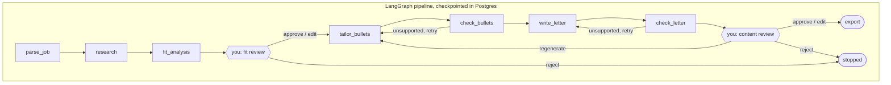
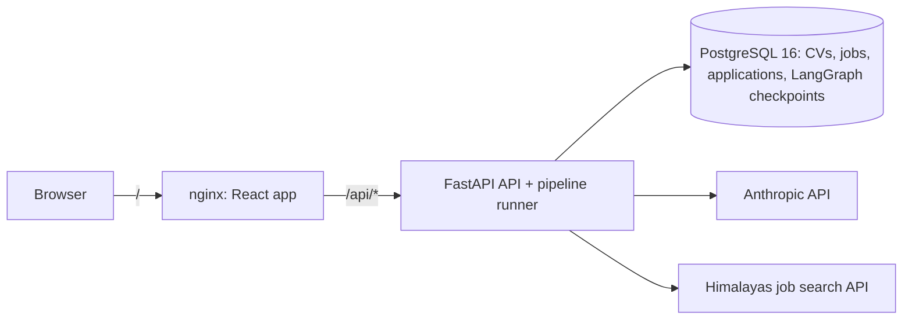

# HireFlow

Upload your CV, find a remote job (or paste a posting), and a multi-agent pipeline parses the job, researches the company, scores your fit, tailors your CV bullets and writes a cover letter. It pauses for your approval at the key steps, and **every claim it writes is checked against your CV before you see it**.

Built with FastAPI, LangGraph (Postgres checkpointer), the Anthropic API, PostgreSQL 16, React + TypeScript + Tailwind, and Docker.

> **Live demo:** _not deployed yet: see [Deploy](#deploy-render)._ The public demo runs in mock mode (canned model output, free).
>
> **Demo GIF:** _to be recorded_ (`docs/demo.gif`).

## How it works





### Why you can trust the output

- **Everything has an ID.** Each CV item (`exp-1.b2`, `skill-3`, …), job requirement (`must-1`) and company fact (`co-2`) gets a code-assigned ID. Every fit verdict, bullet and letter paragraph must cite the IDs it relies on.
- **Code checks first, then a model.** The claim checker rejects citations to IDs that don't exist, and numbers that the cited text doesn't contain. An LLM then judges each item against *only* its cited sources. Failures go back for a rewrite (at most twice), and anything still unsupported is removed and reported to you.
- **The score isn't the model's opinion.** The LLM judges each requirement (met / partial / not met, with evidence). Code computes the score, with must-haves weighted double.
- **Humans can't add fiction either.** Overriding a fit verdict still requires citing real CV evidence.
- **It's measured.** An independent judge (raw CV, no IDs) grades the final output in [`evals/`](evals/); see [docs/evals.md](docs/evals.md).

## Run it locally

**With Docker** (Postgres, API and frontend):

```bash
cp .env.example .env           # set ANTHROPIC_API_KEY, or LLM_MOCK=true to try it for free
docker compose up --build      # open http://localhost:8080
```

**Without Docker** (mock LLM, SQLite, in-memory checkpoints):

```bash
# backend/
uv sync
LLM_MOCK=true DATABASE_URL=sqlite+aiosqlite:///./demo.db uv run alembic upgrade head
LLM_MOCK=true DATABASE_URL=sqlite+aiosqlite:///./demo.db uv run uvicorn app.main:app

# frontend/ (second terminal)
npm install && npm run dev     # open http://localhost:5173
```

In mock mode every CV parses as the sample candidate "Jordan Rivera". That's handy for clicking through the flow, but it isn't a real result.

## Tests and evals

```bash
cd backend && uv run pytest && uv run ruff check .        # API, agents, graph (LLM always mocked)
cd frontend && npm test && npm run lint && npm run typecheck
uv run --project backend pytest evals                      # eval harness (from the repo root)
uv run --project backend python -m evals.run --mock        # full eval run, free
uv run --project backend python -m evals.run               # real model: costs money (docs/evals.md)
```

The Postgres-only tests (migrations, LangGraph checkpointer) run when `TEST_DATABASE_URL` is set; CI sets it.

## Deploy (Render)

1. Push this repo to GitHub.
2. In Render: **New → Blueprint**, then pick the repo. [`render.yaml`](render.yaml) creates `hireflow-api`, `hireflow-web` and a managed Postgres 16 (`hireflow-db`).
3. When prompted for `ANTHROPIC_API_KEY`, leave it empty to keep the free mock demo, or paste a key and set `LLM_MOCK=false`. Every real run is then billed to that key.
4. Open the `hireflow-web` URL.

Notes: free instances sleep when idle, and runs interrupted by sleep resume on wake-up. Free Postgres on Render is time-limited (see Render's free-tier docs). The API must run as **one** instance, because pipeline runs execute inside the API process.

## Project layout

```
backend/app/
  agents/     LangGraph graph, nodes, prompts, Pydantic output models, claim checker
  api/        FastAPI routers and response schemas
  core/       settings, Anthropic client wrapper, mock LLM
  db/         SQLAlchemy models and sessions
  services/   CV text extraction, repositories, pipeline runner
backend/alembic/   migrations
frontend/src/      React app (generated API types in src/api/schema.ts)
evals/             dataset, judge, metrics, runner
docs/              decisions.md (why things are the way they are), evals.md, openapi.json
```

## Status

All 9 phases in [PLAN.md](PLAN.md) are implemented. Job search uses the free [Himalayas](https://himalayas.app/api) API; it doesn't apply to jobs for you. Still open:
- an eval run against the real model (needs an API key: [docs/evals.md](docs/evals.md));
- a real web-search provider for company research (currently the job posting only);
- the live deployment and demo GIF.
